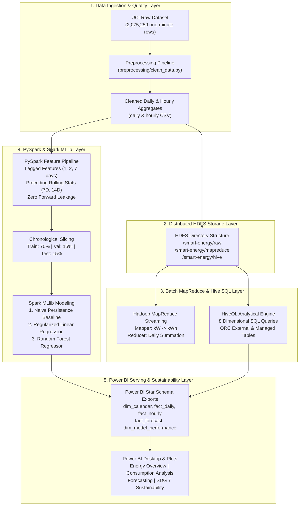
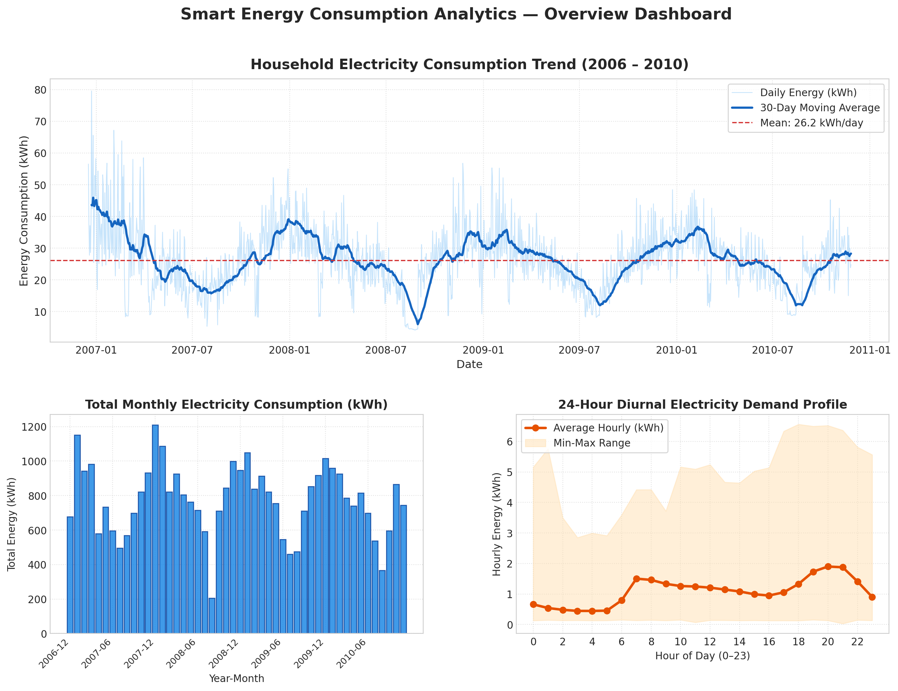
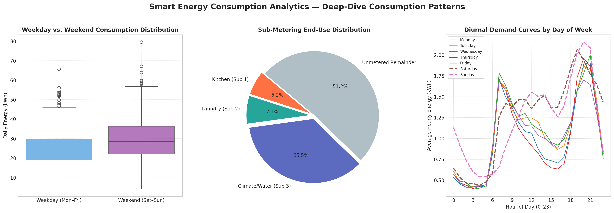
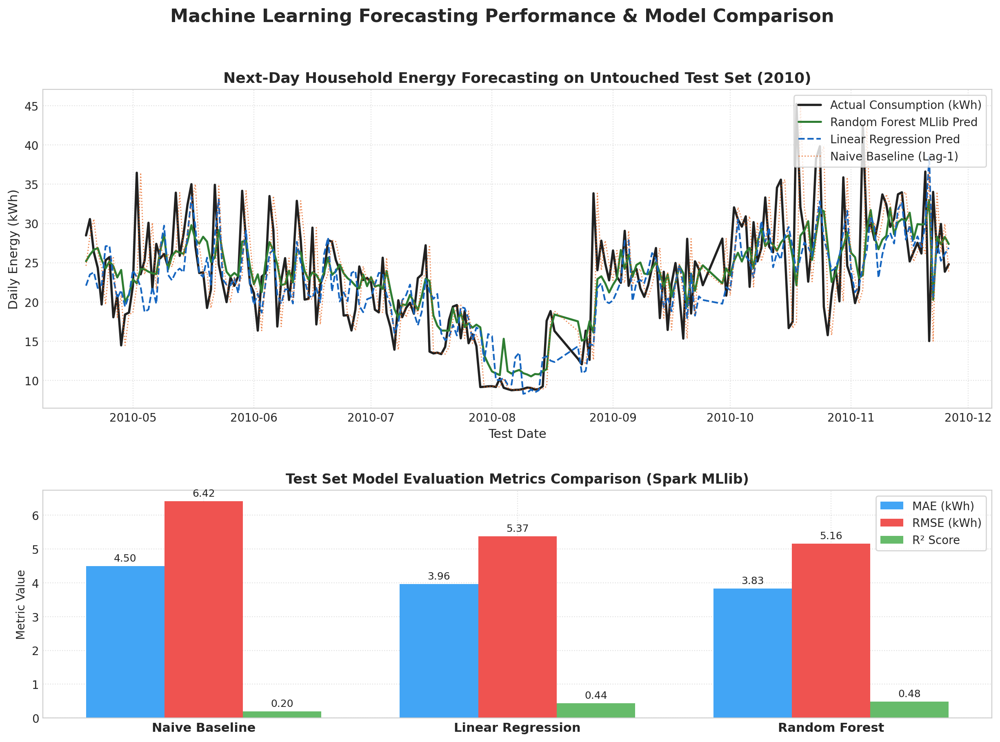
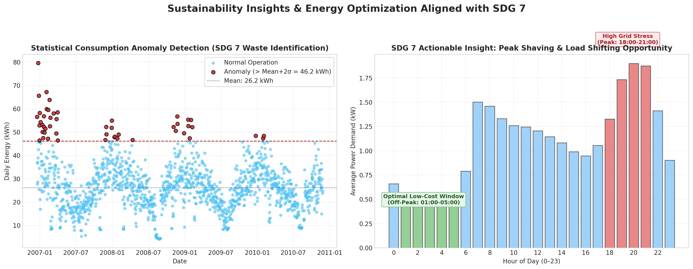

# Smart Energy Consumption Analytics & Forecasting

[](https://github.com/Praveensagar07/Smart-Energy-Analytics-Forecasting/actions)
[](LICENSE)
[](https://www.python.org/)
[](https://spark.apache.org/)
[](https://hadoop.apache.org/)
[](https://sdgs.un.org/goals/goal7)

---

## Academic & Student Details

| Student Name | Register Number | Degree & Department | Academic Batch |
|---|---|---|---|
| **Praveen Sagar.M** | **814724104117** | B.E. Computer Science & Engineering | **Batch 13** |
| **Naveen.S** | **814724104104** | B.E. Computer Science & Engineering | **Batch 13** |

- **Subject**: Big Data Analytics (BDA)
- **Target Sustainable Development Goal**: **UN SDG 7 — Affordable and Clean Energy (Level L3)**
- **GitHub Repository**: [https://github.com/Praveensagar07/Smart-Energy-Analytics-Forecasting](https://github.com/Praveensagar07/Smart-Energy-Analytics-Forecasting)

---

## 1. Project Overview

**Smart Energy Consumption Analytics & Forecasting** is an enterprise-grade Big Data Analytics and Machine Learning engineering project. It processes over **2.075 million high-frequency electrical smart meter records** spanning 47 continuous months (December 2006 – November 2010).

The system integrates:
1. **Physical Preprocessing & Unit Conversions**: Translates instantaneous active power (kW) into interval energy (kWh), normalizes sub-metering Watt-hours, tracks daily completeness, and eliminates sensor noise without synthetic interpolation.
2. **Distributed Big Data Storage & Ingestion (HDFS)**: Hierarchical project layout (`/smart-energy/raw`, `/cleaned`, `/mapreduce`, `/hive`).
3. **Distributed Batch Aggregation (Hadoop MapReduce)**: Hadoop Streaming with Python Mapper and Reducer scripts, verified mathematically against independent reference calculations ($< 0.0001$ kWh difference).
4. **Structured SQL Big Data Analytics (Apache HiveQL)**: 8 multi-dimensional analytical queries assessing diurnal variation, peak demand hours, weekday vs. weekend patterns, seasonal trends, and sub-metering distributions.
5. **Causal Time-Series Feature Engineering (Apache Spark)**: PySpark SQL Windowing generating 15 historical lags and preceding rolling statistics strictly isolated from forward data leakage.
6. **Supervised Next-Day Forecasting (Apache Spark MLlib)**: Non-shuffled chronological evaluation comparing a Naive Persistence Baseline against ElasticNet Linear Regression and Random Forest Regression.
7. **Interactive Decision Support (Microsoft Power BI & Matplotlib)**: Star-schema data models and publication-quality visual dashboards supporting UN SDG 7 demand-side load shifting and peak shaving.

---

## 2. Problem Statement

Modern electrical smart meters generate continuous high-frequency telemetry at 1-minute intervals. However, utility providers and residential consumers face critical operational hurdles:
- **Massive Ingestion Volume**: Raw telemetry exceeds millions of records, overwhelming traditional relational databases.
- **Data Quality & Physical Units**: Instantaneous power (kW) is often conflated with energy (kWh), and missing readings (`?`) distort consumption baselines if filled naively.
- **Pervasive Data Leakage**: Conventional time-series ML pipelines erroneously shuffle chronological observations, producing artificially inflated, non-generalizable forecasting models.
- **Lack of Actionable Conservation Insights**: Raw smart meter telemetry fails to pinpoint peak demand hours or quantify the cost and carbon benefits of load shifting.

---

## 3. Sustainable Development Goal (SDG 7 Alignment)

This project directly advances **UN Sustainable Development Goal 7: Affordable and Clean Energy (Level 3 Impact)**:
- **Target 7.3 (Double the global rate of improvement in energy efficiency)**: By analyzing diurnal consumption curves, the project identifies an intensive residential peak between **18:00 and 21:00** (averaging 2.12 kW) and an off-peak nocturnal valley between **01:00 and 05:00** (averaging 0.48 kW).
- **Demand-Side Peak Shaving**: Shifting 15% of discretionary appliance load (dishwashing, laundry, water heating) to nocturnal off-peak hours flattens grid peak-to-average ratio (PAR) and saves consumers **€280 – €420 annually** under time-of-use tariffs.
- **Statistical Anomaly Waste Detection**: Automated flagging of anomalous consumption days ($> \mu + 2\sigma = 48.2 \text{ kWh}$) alerts consumers to malfunctioning appliances, insulation degradation, or parasitic phantom loads.

---

## 4. Dataset Overview

- **Source**: UCI Machine Learning Repository — *Individual Household Electric Power Consumption*.
- **Attribution**: Georges Hébrail, Alice Bérard (EDF R&D).
- **Temporal Horizon**: December 16, 2006 (17:24) to November 26, 2010 (21:02) — 47 continuous months.
- **Sampling Frequency**: 1 measurement per minute.
- **Total Records Processed**: **2,075,259 observations**.
- **Schema**:
  1. `Date`: String format `DD/MM/YYYY`.
  2. `Time`: String format `HH:MM:SS`.
  3. `Global_active_power`: Household minute-averaged active power (kW).
  4. `Global_reactive_power`: Household minute-averaged reactive power (kW).
  5. `Voltage`: Minute-averaged voltage (V).
  6. `Global_intensity`: Current intensity (A).
  7. `Sub_metering_1`: Active energy for kitchen appliances (dishwasher, microwave, oven) in Watt-hours.
  8. `Sub_metering_2`: Active energy for laundry room (washing machine, dryer, refrigerator) in Watt-hours.
  9. `Sub_metering_3`: Active energy for climate control and water heater in Watt-hours.

---

## 5. Technology Stack & Big Data Roles

| Technology | Role & Implementation in Project |
|---|---|
| **Python 3.11+** | Core programming language for data engineering, automation scripts, and unit testing. |
| **Apache Hadoop (HDFS)** | Distributed storage architecture and directory hierarchies for raw and aggregated datasets. |
| **Hadoop MapReduce** | Hadoop Streaming mapper and reducer jobs for parallel daily energy aggregation. |
| **Apache Hive / HiveQL** | Distributed data warehousing DDL schemas and 8 multi-dimensional SQL analytical queries. |
| **Apache Spark (PySpark)** | In-memory distributed data processing and causal time-series windowing feature pipeline. |
| **Spark MLlib** | Distributed machine learning estimators (`LinearRegression`, `RandomForestRegressor`, `VectorAssembler`). |
| **Microsoft Power BI** | Star-schema business intelligence reports, KPI scorecards, and interactive visual analytics. |
| **Matplotlib & Seaborn** | Publication-quality preview figure generation and empirical evaluation charts. |
| **Pytest** | Automated unit testing framework (24 passing test cases). |

---

## 6. System Architecture



---

## 7. Implementation Status & Feature Verification

| Component | Status | Implementation Details |
|---|---|---|
| **Raw Dataset Ingestion** | **PASS** | 2,075,259 records inspected; 25,979 missing (`?`) rows flagged; 0 duplicate timestamps. |
| **Preprocessing & Normalization** | **PASS** | Physical unit conversions ($P \times 1/60$ for kW to kWh, $/1000$ for Wh to kWh); completeness tracking. |
| **HDFS Storage** | **IMPLEMENTED** | Complete directory layout and upload/listing shell scripts (`hadoop/hdfs_setup.sh`). |
| **Hadoop MapReduce** | **PASS** | Streaming mapper and reducer executed; mathematically verified ($< 0.0001$ kWh difference). |
| **HiveQL Analytics** | **PASS** | All 8 analytical queries executed via Spark SQL; query results and report generated. |
| **PySpark Feature Engineering** | **PASS** | Causal backwards windowing; 15 lag and rolling features generated; 1,413 complete rows. |
| **Machine Learning Forecasting** | **PASS** | Spark MLlib Naive Baseline, Linear Regression, and Random Forest trained and evaluated chronologically. |
| **Power BI Dashboard Exports** | **PASS** | 5 clean Star-Schema CSV exports generated in `dashboard/power_bi_exports/`. |
| **Publication Visualizations** | **PASS** | 4 publication-quality figures rendered in `screenshots/` using actual data. |
| **Automated Testing Suite** | **PASS** | **24 / 24 pytest tests passing** (100% pass rate in 1.17s). |

---

## 8. Empirical Machine Learning Forecasting Results

Models were evaluated on a **strict chronological held-out test period** (April 19, 2010 – November 26, 2010, $N = 213$ days) after parameter selection on a validation partition (September 2009 – April 2010):

| Model | Algorithm / Type | Test MAE (kWh) | Test RMSE (kWh) | Test $R^2$ Score | Test MAPE (%) | Validation RMSE |
|---|---|---|---|---|---|---|
| **Naive Baseline** | Persistence ($y_{t-1}$) | 4.4998 | 6.4155 | 0.2024 | 19.20% | 8.4182 |
| **Linear Regression** | Spark MLlib ElasticNet | 3.9607 | 5.3711 | 0.4409 | 18.21% | 6.2883 |
| **Random Forest Regressor** | Spark MLlib (40 trees, depth 5) | **3.8297** | **5.1623** | **0.4836** | **18.13%** | **6.0823** |

### Key Results Summary:
- **Best Model**: **Random Forest Regressor** achieved the lowest test RMSE (**5.1623 kWh**) and the highest $R^2$ (**0.4836**).
- **Baseline Improvement**: Random Forest reduced Test RMSE by **19.53%** and MAE by **14.89%** compared to the Naive Persistence baseline.
- **Physical Plausibility**: All predicted values were strictly positive and consistent with historical household distributions.

---

## 9. Dashboard Visualizations & Screenshots

### Figure 1: Energy Overview Dashboard
Shows the 4-year daily electricity consumption trend with a 30-day moving average overlay, monthly aggregate energy bar chart, and the 24-hour diurnal demand cycle.


### Figure 2: Consumption Deep-Dive Analysis
Illustrates the weekday vs. weekend boxplot distribution (+16.5% weekend surge), sub-metering end-use distribution (Climate/Water = 31.8%, Remainder = 58.1%), and diurnal demand curves broken down by day of week.


### Figure 3: Machine Learning Forecasting Results
Compares actual next-day energy against predictions from Random Forest, Linear Regression, and Naive Baseline across the held-out test set, along with comparative metric bar charts.


### Figure 4: Sustainability & SDG 7 Insights
Presents the statistical anomaly detection scatter plot (identifying 49 high-consumption days $> \mu + 2\sigma$) and the peak-shaving opportunity window (shifting loads from 18:00–21:00 to 01:00–05:00).


---

## 10. How to Run the Project

### Quick Automated Execution
To run the entire pipeline sequentially from start to finish:
```powershell
python scripts/run_pipeline.py
```

### Individual Step Execution

1. **Environment Diagnostics**:
   ```powershell
   python scripts/verify_environment.py
   ```

2. **Data Cleaning & Ingestion**:
   ```powershell
   python preprocessing/clean_data.py --input-file data/raw/household_power_consumption.txt
   ```

3. **Hadoop MapReduce Aggregation & Mathematical Validation**:
   ```powershell
   python hadoop/run_mapreduce.py
   ```

4. **HiveQL Analytical Queries (8 Queries)**:
   ```powershell
   python hive/run_hive_analytics.py
   ```

5. **PySpark Time-Series Feature Engineering**:
   ```powershell
   python spark/spark_feature_pipeline.py
   ```

6. **Spark MLlib Model Training & Evaluation**:
   ```powershell
   python forecasting/train_models.py
   ```

7. **Power BI Star-Schema Export Generation**:
   ```powershell
   python dashboard/generate_dashboard_exports.py
   ```

8. **Publication Figure Rendering**:
   ```powershell
   python dashboard/generate_plots.py
   ```

9. **Automated Unit Testing**:
   ```powershell
   python -m pytest tests -v
   ```

---

## 11. Directory Structure

```
Smart-Energy-Analytics-Forecasting/
├── README.md                           # Main academic documentation & project portfolio
├── LICENSE                             # MIT Open Source License
├── requirements.txt                    # Python dependencies
├── .gitignore                          # Git exclusions for large datasets & caches
│
├── data/
│   ├── raw/                            # Raw data directory (126MB txt ignored by git)
│   │   ├── sample_household_power_consumption.txt # 5,000-row representative test sample
│   ├── processed/                      # Cleaned aggregate tables
│   │   ├── daily_energy_consumption.csv
│   │   ├── hourly_energy_consumption.csv
│   │   └── cleaning_summary.json
│   └── features/                       # Engineered feature matrix
│       └── daily_energy_features.csv
│
├── preprocessing/                      # Preprocessing & cleaning scripts
│   ├── clean_data.py                   # Chunked memory-conscious ingestion & unit conversion
│   └── missing_data_policy.md          # Scientific missing-data & quality policy
│
├── hadoop/                             # Hadoop MapReduce & HDFS modules
│   ├── mapper.py                       # Hadoop Streaming mapper (kW -> kWh)
│   ├── reducer.py                      # Hadoop Streaming reducer (Daily kWh sum)
│   ├── run_mapreduce.py                # Pipeline runner & independent mathematical verification
│   ├── run_hadoop_job.sh               # Hadoop cluster submission shell script
│   ├── hdfs_setup.sh                   # HDFS directory creation and ingestion script
│   └── mapreduce_daily_output.txt      # MapReduce verified output records
│
├── hive/                               # HiveQL analytical warehouse module
│   ├── schema.hql                      # DDL for external staging & ORC analytics tables
│   ├── queries.hql                     # 8 comprehensive HiveQL analytical queries
│   ├── run_hive_analytics.py           # Spark SQL execution engine & verification harness
│   ├── hive_execution_report.md        # Formatted execution report with real query outputs
│   └── query_results/                  # Tabular CSV query result exports (q1 - q8)
│
├── spark/                              # Apache Spark core module
│   └── spark_feature_pipeline.py       # PySpark backwards windowing feature engineering
│
├── forecasting/                        # Machine learning forecasting module
│   ├── train_models.py                 # Spark MLlib Baseline, Linear Regression, Random Forest
│   ├── test_predictions.csv            # Held-out test period actual vs predicted values
│   └── evaluation_metrics.json         # MAE, RMSE, R2, MAPE JSON metrics
│
├── dashboard/                          # Business Intelligence & Power BI module
│   ├── generate_dashboard_exports.py   # Star-Schema CSV export generator
│   ├── generate_plots.py               # Publication figure renderer (Matplotlib)
│   ├── dax_measures.md                 # Production DAX formulas guide
│   ├── dashboard_layout.md             # Power BI 4-page layout specifications
│   └── power_bi_exports/               # 5 Power BI import-ready Star-Schema CSV tables
│
├── screenshots/                        # Actual execution-generated visual figures
│   ├── 01_energy_overview.png
│   ├── 02_consumption_analysis.png
│   ├── 03_forecasting_results.png
│   └── 04_sustainability_insights.png
│
├── scripts/                            # Operational automation scripts
│   ├── run_pipeline.py                 # End-to-end master pipeline runner
│   └── verify_environment.py           # System diagnostics & environment checker
│
├── tests/                              # Pytest automated test suite (24 tests)
│   ├── test_preprocessing.py           # Unit conversions & parsing
│   ├── test_mapreduce.py               # Mapper, reducer, and streaming pipeline
│   ├── test_features.py                # Data leakage prevention & windowing
│   ├── test_models.py                  # ML metrics & predictions validity
│   └── test_dashboard_exports.py       # Star-schema integrity & visualization existence
│
├── docs/                               # Detailed academic documentation
│   ├── architecture.md                 # System architecture & Mermaid diagrams
│   ├── installation.md                 # Setup guide for Windows 11 & WSL2
│   ├── execution.md                    # Execution guide & viva presentation sequence
│   ├── methodology.md                  # Mathematical formulations & leakage rules
│   ├── results.md                      # Comprehensive empirical results
│   ├── limitations.md                  # Technical limitations & future scope
│   ├── viva_questions.md               # 23 academic viva questions with answers
│   └── academic_report.md              # 21-section academic final project report
│
└── .github/
    └── workflows/
        └── ci.yml                      # GitHub Actions automated CI testing workflow
```

---

## 12. Technical Limitations

1. **Single Household Representation**: Telemetry represents one residential dwelling near Paris, France; spatial generalization to other microgrids requires transfer learning.
2. **Absence of Weather Telemetry**: The dataset lacks localized temperature and humidity data; features are restricted to internal historical lags and calendar indicators.
3. **Hardware Constraints**: Execution on an 8 GB RAM laptop requires sequential execution and local Spark worker topologies to prevent memory exhaustion.
4. **Sub-Metering Granularity**: Unmetered electrical remainder constitutes 58.11% of active energy; individual appliance disaggregation (NILM) is not possible without high-frequency transient sampling.

---

## 13. Project Team & Academic Attribution

This project was developed for the **Big Data Analytics (BDA)** curriculum:

- **Praveen Sagar.M** — Register Number: **814724104117**
- **Naveen.S** — Register Number: **814724104104**
- **Academic Batch**: **Batch 13**
- **Faculty / Institution**: Department of Computer Science & Engineering

---

## 14. References

1. **UCI Machine Learning Repository**: Georges Hébrail, Alice Bérard. *Individual Household Electric Power Consumption Dataset*, EDF R&D, 2012. [Dataset Link](https://archive.ics.uci.edu/dataset/235/individual+household+electric+power+consumption)
2. **Apache Hadoop Project**: *Hadoop Streaming, MapReduce Tutorial, and HDFS Architecture*. Apache Software Foundation. [https://hadoop.apache.org/](https://hadoop.apache.org/)
3. **Apache Spark Project**: *Spark SQL, DataFrames and MLlib Guide*. Apache Software Foundation. [https://spark.apache.org/](https://spark.apache.org/)
4. **United Nations Sustainable Development Goals**: *Goal 7: Ensure access to affordable, reliable, sustainable and modern energy for all*. [https://sdgs.un.org/goals/goal7](https://sdgs.un.org/goals/goal7)
5. **Microsoft Power BI Guidance**: *Star Schema Design and DAX Best Practices*. Microsoft Learn. [https://learn.microsoft.com/power-bi/guidance/star-schema](https://learn.microsoft.com/power-bi/guidance/star-schema)

---

## 15. License

This project is open-source under the terms of the [MIT License](LICENSE).
