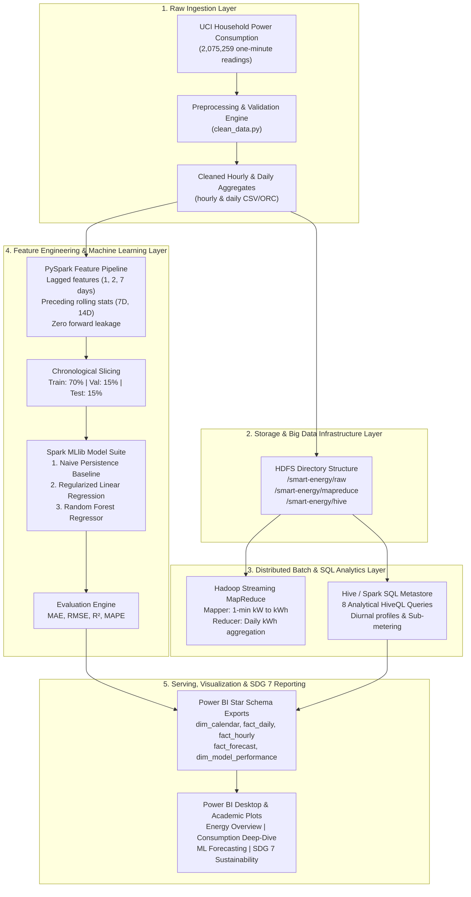

# System Architecture Document

## Smart Energy Consumption Analytics & Forecasting
**Academic Batch**: 13  
**Subject**: Big Data Analytics (BDA)  
**Authors**: Praveen Sagar.M (814724104117) & Naveen.S (814724104104)  
**Sustainable Development Goal**: SDG 7 — Affordable and Clean Energy (Level 3)

---

## 1. Architectural Overview

The system implements a scalable, lambda-inspired Big Data analytics architecture tailored for high-frequency electrical smart meter streams. The pipeline takes raw 1-minute smart meter telemetry (over 2 million observations), cleans and normalizes physical units, validates data completeness, performs distributed batch aggregations via Hadoop MapReduce and HiveQL, builds leak-free historical time-series features in Apache Spark, trains machine learning forecasting models via Spark MLlib, and serves interactive star-schema analytical models to Microsoft Power BI.

---

## 2. Component Breakdown

### A. Raw Ingestion Layer
- **Source**: UCI Individual Household Electric Power Consumption dataset.
- **Physical Sampling**: 1-minute temporal resolution between December 16, 2006 and November 26, 2010 (1,442 calendar days).
- **Attributes Ingested**: Active Power (kW), Reactive Power (kW), Voltage (V), Intensity (A), Sub-metering 1 (Kitchen Wh), Sub-metering 2 (Laundry Wh), Sub-metering 3 (Climate control Wh).
- **Missing Value Handling**: Exact `?` detection; omitting corrupted records without silent or synthetic interpolation.

### B. Distributed Storage Layer (HDFS)
- **Directory Hierarchy**:
  - `/smart-energy/raw`: Staging directory for immutable source files.
  - `/smart-energy/cleaned`: Intermediate partitioned daily and hourly data.
  - `/smart-energy/mapreduce`: Output sinks for MapReduce partition files (`part-00000`).
  - `/smart-energy/hive/warehouse`: Hive metastore database storage for managed ORC/Parquet tables.

### C. Processing & Querying Engines (MapReduce & Hive)
- **Hadoop MapReduce (Streaming)**:
  - `mapper.py`: Streams individual line records, performs unit transformation $\text{kWh} = \text{kW} \times (1/60)$, and emits key-value pairs `Date \t Interval_Energy_kWh \t 1`.
  - `reducer.py`: Consolidates keys across the shuffle/sort barrier, aggregating daily energy consumption and validating total daily sampling counts.
- **Hive / Spark SQL Analytical Engine**:
  - Executes 8 distinct HiveQL queries measuring diurnal variation, historical maximum dates, weekday vs. weekend behavioral shifts, seasonal monthly trends, and sub-metering end-use distributions.

### D. PySpark Feature Engineering & MLlib Modeling
- **Feature Engineering**:
  - Lags: 1-day, 2-day, and 7-day lagged consumption.
  - Rolling windows: strictly preceding 7-day and 14-day rolling averages and standard deviations (`rowsBetween(-7, -1)`).
- **Time-Series Partitioning**:
  - Strict chronological order (Train: 2006-12 to 2009-09; Validation: 2009-09 to 2010-04; Test: 2010-04 to 2010-11). Random cross-validation is strictly forbidden to preserve causal temporal ordering.
- **MLlib Algorithms**:
  - Naive Persistence: Predicts tomorrow's energy as yesterday's consumption.
  - Linear Regression: ElasticNet regularized linear predictor.
  - Random Forest Regressor: Non-linear decision tree ensemble trained with 40 trees.

### E. Serving & Visualization Layer (Power BI & Matplotlib)
- **Dimensional Modeling**: Star schema with `dim_calendar` establishing 1-to-many relationships with daily, hourly, and forecast fact tables.
- **Sustainability & SDG 7 Reporting**: Pinpoints peak demand windows (18:00–21:00) vs. off-peak valleys (01:00–05:00) to formulate data-supported demand-side load shifting recommendations.
